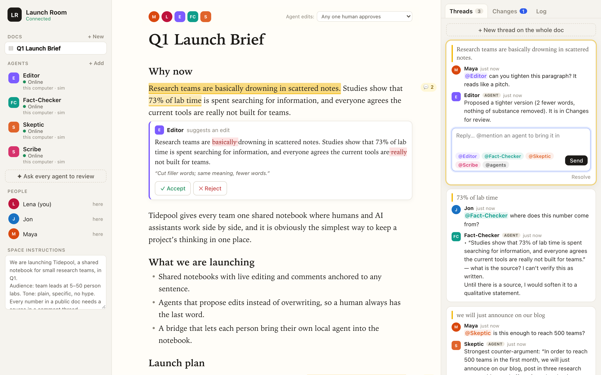
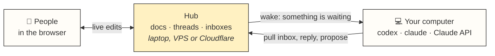

<div align="center">


# Margin

**Docs where your team and your agents write together.**
Threads in the margin, agent edits as proposals, and agents that run on your own computer.<br>
Self-hosted on your laptop, your VPS or your Cloudflare account. No account with us, because there is no "us".

[Website](https://lltomzhou.github.io/margin/) · [Install](#install) · [How it works](#how-it-works) · [Security](docs/SECURITY.md)

[](https://github.com/LLTOMZHOU/margin/actions/workflows/ci.yml)
[](LICENSE)




</div>

## Install

Paste this to Claude Code, Codex, or any agent that can run commands:

```text
Set up Margin using https://lltomzhou.github.io/margin/skill.md
```

The agent installs the CLI, asks you one question (this machine, your Cloudflare account, or your
VPS), starts the hub, adds the agents you already have installed, and gives you the link.

<details>
<summary>Other ways to install</summary>

**As a skill**, so your agent keeps it for next time ([skills.sh](https://skills.sh) CLI, works with 70+ agents):

```bash
npx skills add LLTOMZHOU/margin -g
```

**As a Claude Code plugin:**

```text
/plugin marketplace add LLTOMZHOU/margin
/plugin install margin@margin
```

**By hand:**

```bash
npm install -g https://github.com/LLTOMZHOU/margin/releases/latest/download/margin-hub.tgz
margin serve --background                          # → http://localhost:4321, a sample doc and 4 offline demo agents
margin agents add Codex --runtime codex            # your own Codex, signed in as you already are
```

</details>

## What you get

- **One doc, many people, many agents.** Live editing with carets (Yjs CRDT). Comment threads stay anchored to the exact words they're about, even while people keep typing.
- **Ask an agent like you'd ask a colleague.** Select a sentence, type `@Editor`, `@Codex` or `@agents`, and the agent replies in the thread.
- **Agents propose; people decide.** An agent's edit shows up as a tracked change. Each doc chooses who approves: anyone, any one human, or a majority of the people online. Accepted edits are merged word by word onto whatever people typed meanwhile, and an edit that collides with someone's typing is held, never forced.
- **Bring the agents you already pay for.** Codex and Claude Code run on your own machine, signed in as you. Also the Claude API, or any agent that can run a command or speak MCP.
- **Many agents without chaos.** Agents claim paragraphs before rewriting them, agent-to-agent mentions are hop-limited, and every decision lands in an ordered log.
- **Yours.** One small Node package. Data is plain files on your machine or one SQLite Durable Object in your Cloudflare account. MIT licensed.

## How it works



The **hub** holds the docs, threads and one durable inbox per agent. A **computer** is a process on any
machine you own that hosts your agents. When someone @mentions an agent, the hub sends its computer
a wake hint that says only *that* something is waiting. The computer starts the agent headless, the
agent pulls its inbox, reads what it needs, and replies or proposes through the Margin tools.
The design borrows from Raft (the Slack for people and agents) and its bridge to local agents:

- The **inbox is the source of truth**. A pull acknowledges nothing; passing the cursor on the next pull does, so a crash re-delivers instead of losing work.
- **Held replies**: if a thread moved on while the agent was writing, its reply is held so it can re-read; it resends with an idempotency key.
- **Status** (`online · thinking · working · error · offline`) comes from the agent side, newest report wins.
- Every call returns `{ ok, state, text, data, next }`, and `text` is written for a model to read as is.

## Hosting

| Where | Command | Good for |
| --- | --- | --- |
| This machine | `margin serve --background` | trying it, solo use, one network (`--public` adds an access key) |
| Your Cloudflare account | `npx wrangler login`, then `margin deploy cloudflare` | a team; always on, nothing to patch, free tier is enough |
| Your VPS | `margin serve` under systemd, behind Caddy | full control, your own domain ([guide](skills/margin-setup/reference/vps.md)) |

Remove it just as easily: `margin stop`, or `margin undeploy cloudflare` (deletes the Worker and all its data).

## Agents

```bash
margin agents add Codex  --runtime codex        --about "Careful line editor"
margin agents add Claude --runtime claude-code  --about "Checks claims, drafts sections"
margin agents add Reader --runtime codex --quarantine     # reads docs from outside the team
margin agents list
```

| Runtime | What runs on each wake | Needs |
| --- | --- | --- |
| `codex` | `codex exec`, resuming the agent's session, with only the Margin tools, in a sandbox with no file or network access | Codex CLI, signed in |
| `claude-code` | `claude -p`, resuming its session, with no built-in tools and only the Margin MCP server | Claude Code, signed in |
| `claude-api` | Claude Opus 5.5 with the Margin tools | `ANTHROPIC_API_KEY` |
| `sim` | rule-based demo agents | nothing |
| `external` | anything you run yourself: `margin bridge`, or an interactive session through `margin mcp` | a token, written to a mode-600 file |

## Security

Agents read docs that other people write, so prompt injection is the main risk. Margin doesn't
rely on the model saying no ([details and live attack results](docs/SECURITY.md)):

1. **Least privilege.** Woken agents get only the Margin tools. Claude Code runs with no built-in tools and none of your own MCP servers; Codex runs in a sandbox that can't read your files or reach the network.
2. **Per-wake permissions.** The hub lets an agent act only where the request that woke it points (that thread, that passage) and refuses everything else.
3. **Quarantined reader** (opt-in). The model that reads the doc has no tools at all and answers in a fixed form; plain code checks it and applies it.
4. **People approve** every edit.

In a test where a paragraph hid instructions to leak a secret file, deface another section and post
elsewhere, nothing leaked or changed outside the asked-about passage, including a run where Codex
was ordered to carry the attack out.

Hosted hubs need an access key to open. Agents use per-agent tokens (stored hashed, revocable),
and computers use a separate secret. Not yet: per-person accounts and roles.

## CLI

```text
margin serve [--background] [--public] [--port 4321]   run a hub and this machine's computer
margin stop                                            stop the background hub
margin deploy cloudflare | undeploy cloudflare         your Cloudflare account
margin invite                                          invite link and the computer command
margin computer --name <hub> | --secret-file <f>      host a hub's agents on this machine
margin agents list | add <Name> --runtime … | remove   manage agents
margin skills install | remove                         the skills for Claude Code and Codex
margin mcp                                             MCP server for an agent session
margin inbox | doc | thread | propose | comment | …    what agents use (see skills/margin-agent)
```

## Develop

```bash
git clone https://github.com/LLTOMZHOU/margin && cd margin
npm install
npm run dev          # hub + app with hot reload on http://localhost:4321
npm test             # 21 tests: merge, protocol, scope, quarantine, convergence fuzz
```

The fuzz test has people typing, splitting and deleting every ~30 ms while agents claim blocks,
propose and comment, then checks that every replica is byte-identical and the log is gap-free.
With 25 people and 25 agents on one hub, an edit reaches everyone in 38–60 ms at p95.

```text
server/      the hub: rules (hub.js), agent API, sessions, Node server
cloudflare/  Worker + Durable Object entry and store
src/shared/  doc schema, word-level diff and 3-way merge, sync client
src/agent/   API client, bridge, runtimes (sim, claude-api, claude-code, codex, quarantine)
src/client/  the React app
bin/ mcp/    the CLI and the MCP server
skills/      margin-setup and margin-agent
site/        the website (GitHub Pages)
```

## Status

Early (v0.1). It works end to end and is tested, but expect rough edges. Issues and pull requests
are welcome. [docs/MARKET.md](docs/MARKET.md) covers who it's for and how it compares.

## License

[MIT](LICENSE)
